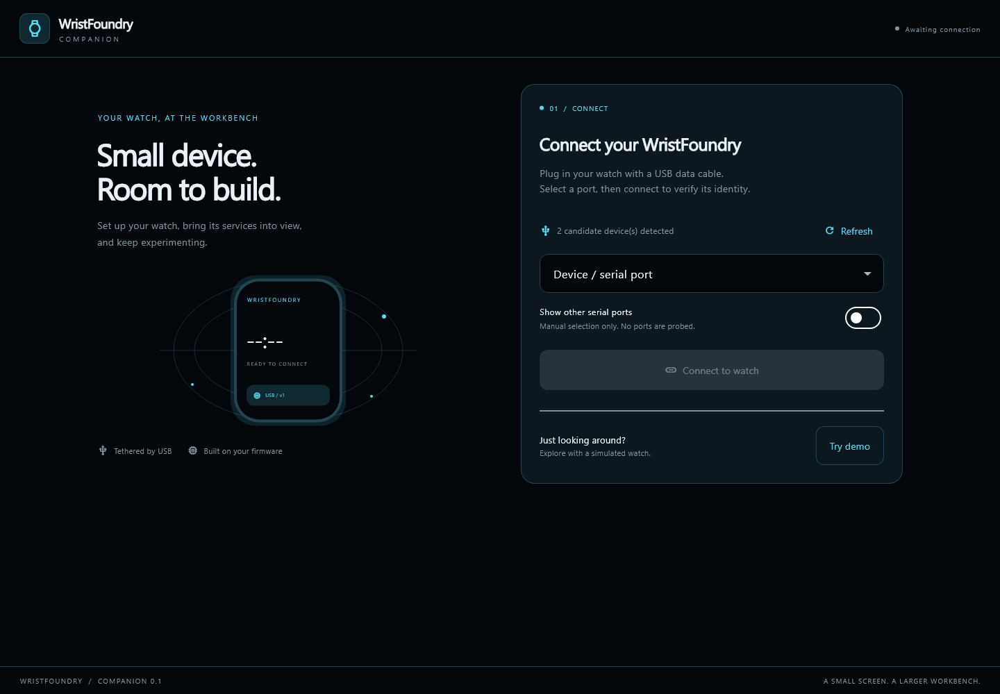
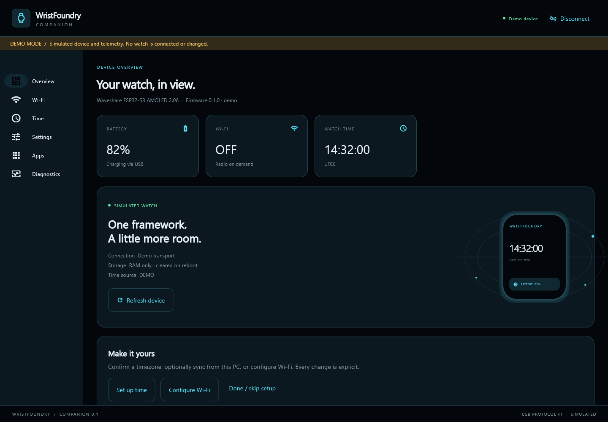
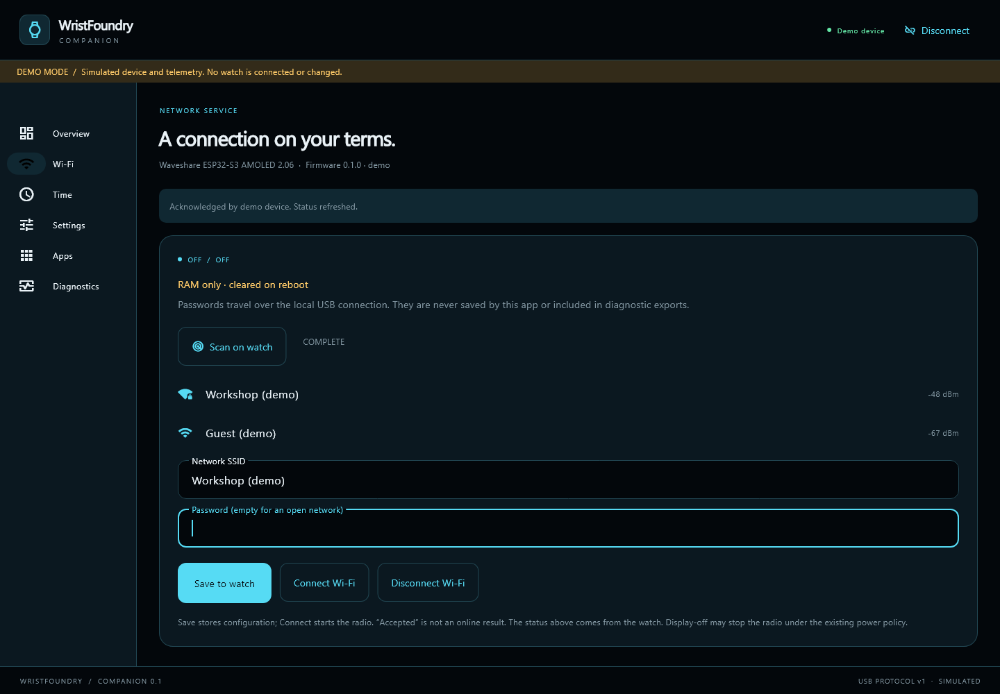
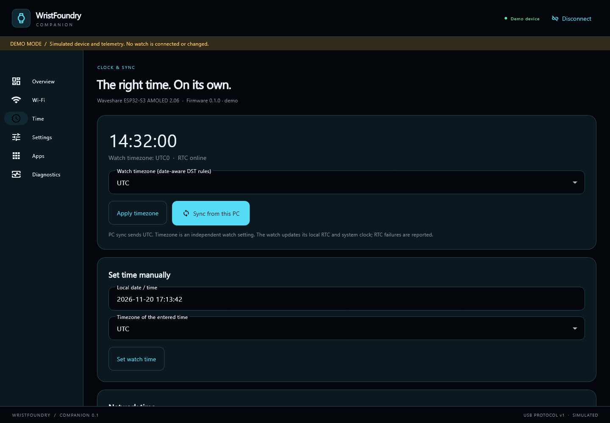
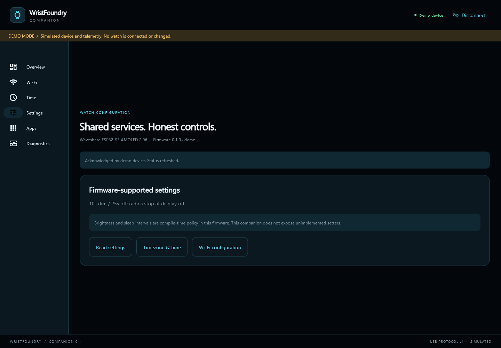
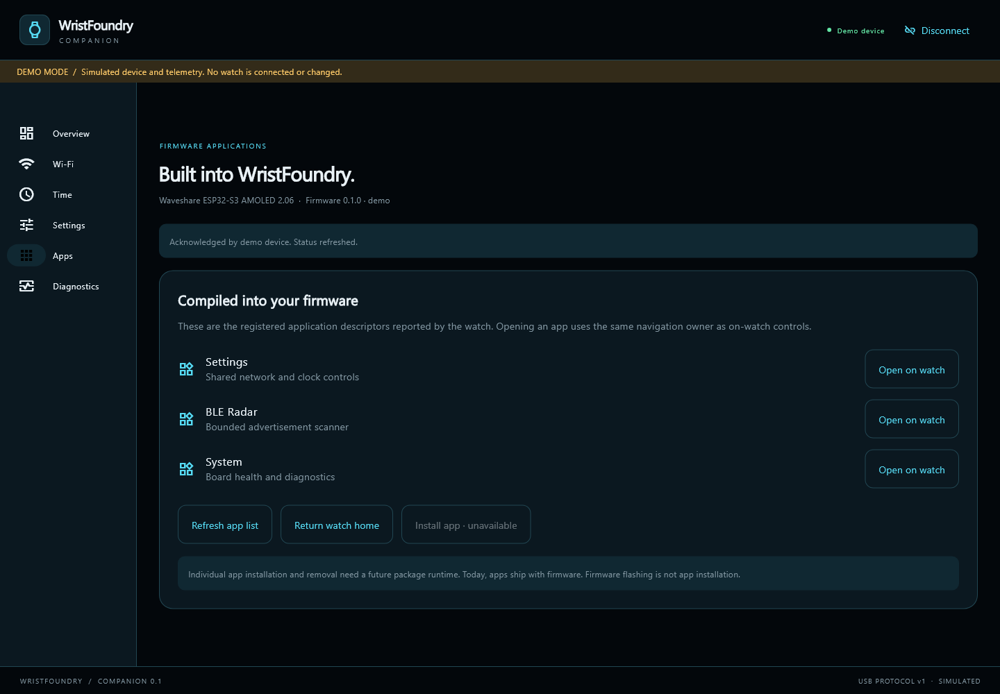
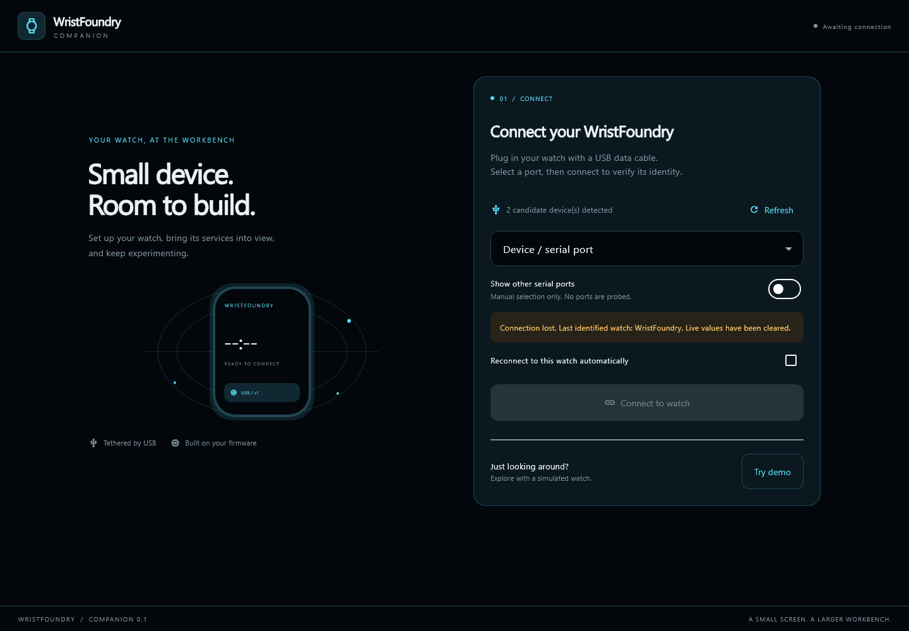

# Companion UI review

Actual Flutter widget renders at 1440 x 1000, captured on Windows CI from
source `81b28a6daae4f4509191a28c90ed92ae40b0fb2c` on 2026-11-20.
These use fixture discovery and the explicitly labeled demo transport. They
are not generated mockups, native-window screenshots, or live hardware evidence.

The [successful Companion run](https://github.com/macroflux/wristfoundry/actions/runs/44780694614)
contains the original PNG artifact, all 23 passing Flutter tests, analysis,
Windows x64 release build, and full-runtime packaging results. The first
no-device capture had incomplete first-frame painting and is omitted here;
the settled Connect view below shows two fixture candidates. The diagnostics
capture also remains only in the original artifact: the widget-test renderer
did not load Consolas and drew its report text as boxes. This does not establish
native Windows text rendering; that remains a clean-PC acceptance check. See the
[validation record](COMPANION_VALIDATION.md) for build scope and remaining gates.

## Welcome / Connect with multiple candidates

Enumeration does not open ports. The user selects a device and explicitly
connects before identity, capabilities, and live information are requested.

## Dashboard

## Wi-Fi

Save and Connect are separate actions. The capture follows a successful
simulated save; the password field has been cleared.

## Time

## Watch settings

## Compiled applications

App information and opening an existing app are supported. Individual app
installation is explicitly unavailable until a future package runtime exists.

## Disconnected

Live values are cleared immediately; reconnecting requires a fresh identity
and capabilities exchange.

